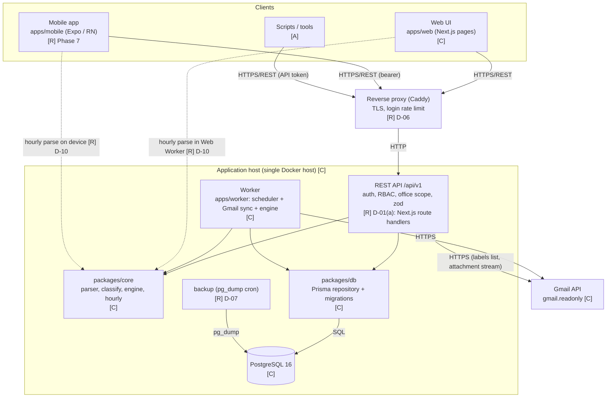
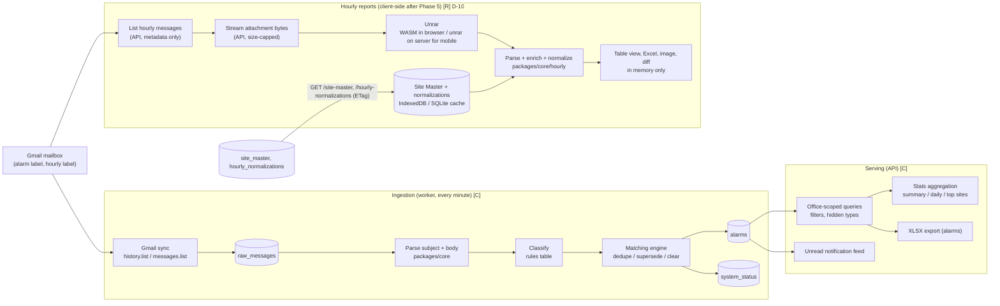
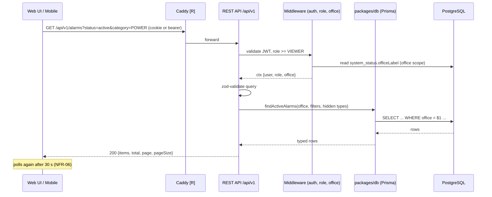
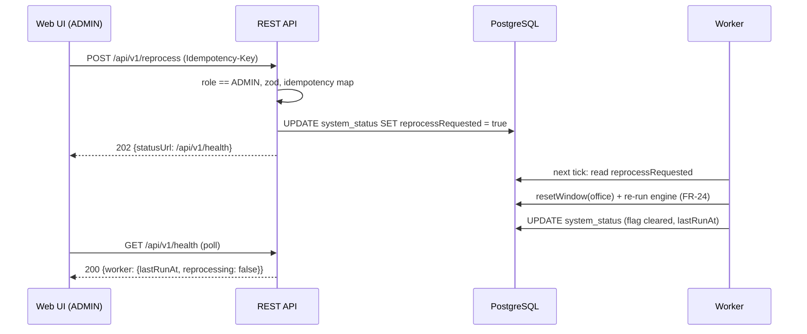
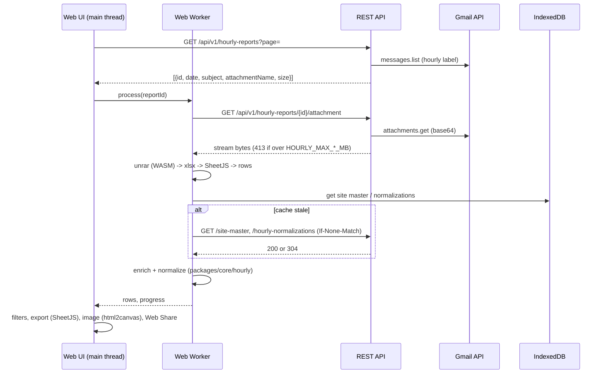
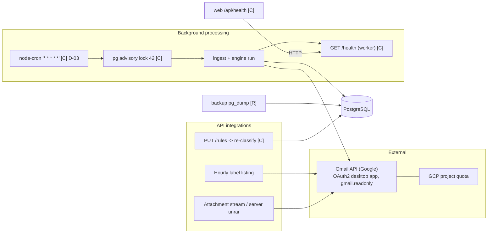
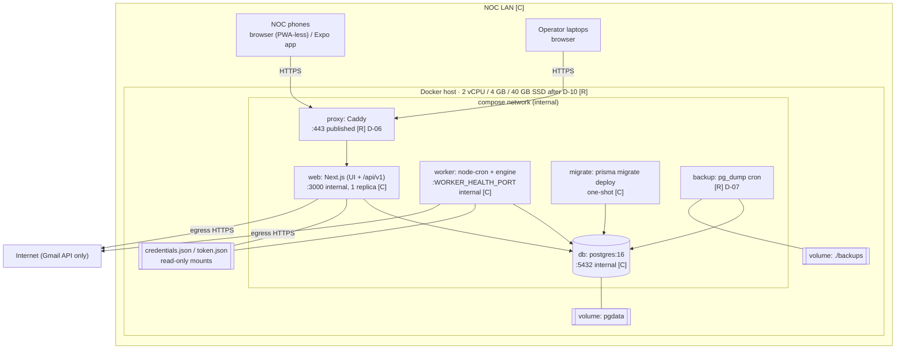

# Alarm Filter — Software Architecture

**Status:** DRAFT for review — derived from `REQUIREMENTS.md` (2026-10-14) and `docs/PROJECT_PLAN.md` v2. Nothing here changes an approved requirement, business rule or plan item; where the plan leaves a decision open, this document shows the recommended option and marks it as such.

**Legend used throughout**

| Tag | Meaning |
|---|---|
| **[C]** | Confirmed — exists in the codebase today or is an already-approved plan item |
| **[R]** | Recommended — the option the plan recommends (D-xx) but which still needs sign-off |
| **[A]** | Assumption — not stated anywhere; listed in §9 as a question |

Business rules (matching engine FR-10…FR-24, roles FR-27, hourly parsing FR-53…FR-56) are **not** redefined here; they live in `packages/core` and are reused unchanged by every client.

---

## 1. High-level architecture

Key properties:

- **One source of truth** — PostgreSQL; the worker and the API share it and never call each other over the network. Worker ⇄ API coordination happens through DB rows (`system_status.reprocessRequested`, `lastRunAt`) **[C]**.
- **One copy of the business rules** — `packages/core` is pure TypeScript and runs in Node (worker, API), in the browser (Web Worker) and in React Native (Hermes) **[C]** for Node, **[R]** for the two clients.
- **No Redis, no queue** — single `web` replica, in-memory maps for login counters and idempotency keys **[C]** (plan D-04).
- **Hourly report data never persists** — on the server after Phase 5 it is only streamed; on clients it lives in memory for the session **[R]** D-10.

---

## 2. Component architecture

### 2.1 Web UI — `apps/web` (pages) **[C]**

| | |
|---|---|
| Responsibility | Render alarm views, stats, settings, hourly reports; poll for updates (30 s active / 60 s cleared / 20 s notifications, NFR-06); run the client-side hourly pipeline after Phase 5 |
| Inputs | User actions; JSON from `/api/v1`; attachment bytes from `/api/v1/hourly-reports/{id}/attachment` (Phase 5) |
| Outputs | REST calls; client-generated Excel/image/clipboard/Web Share for hourly reports (FR-59–FR-64) |
| Dependencies | REST API; `packages/core/hourly` (Phase 5); IndexedDB for reference data (P5-T04); `node-unrar-js` WASM; SheetJS; html2canvas |
| Communication | HTTPS/REST (JSON); `fetch` streaming for attachments; `postMessage` to Web Worker |
| Constraints | No Node APIs in pipeline code; no file written to disk; needs secure context (HTTPS) for Web Share/clipboard (NFR-38) |

### 2.2 REST API — `/api/v1` **[R] D-01(a)** (currently Next.js Route Handlers `/api/*` **[C]**)

| | |
|---|---|
| Responsibility | Single entry point for all clients. Authentication (NextAuth credentials → JWT 12 h, bcrypt), RBAC (VIEWER < OPERATOR < ADMIN), office scoping injected once per request (P3-T05), zod validation, uniform error envelope `{ error: { code, message, details? } }` (P3-T02), OpenAPI 3.1 (P3-T03), login lockout (P3-T06), optional API tokens (P3-T07), idempotency keys (P3-T08) |
| Inputs | HTTP requests (JSON, query params); session cookie or `Authorization: Bearer` |
| Outputs | JSON; XLSX stream (`/alarms/export`); raw attachment stream and server-unrarred XLSX (`/hourly-reports/{id}/attachment`, `…/xlsx`, P5-T01); 202 + status URL for `reprocess` |
| Dependencies | `packages/db` (Prisma), `packages/core` (classify for `PUT /rules` re-classification), Gmail API (hourly label listing and attachment fetch only), `unrar` binary (only for the `/xlsx` route, D-11a) |
| Communication | HTTP/REST in; SQL via Prisma out; HTTPS to Gmail |
| Resources (per plan) | Owns the resources listed in PROJECT_PLAN §5 Phase 3 and REQUIREMENTS §3: `/auth/*`, `/users`, `/me/*`, `/alarms` (+ `?status=`), `/alarms/export`, `/alarm-names`, `/stats/*`, `/rules`, `/settings/*`, `/reprocess`, `/notifications*`, `/hourly-reports` (+ `/attachment`, `/xlsx`), `/hourly-normalizations`, `/site-master*`, `/health` |

If D-01(b) is chosen instead, this component becomes `apps/api` (Fastify) with identical contracts; nothing else in this document changes except the deployment diagram (one more container).

### 2.3 Worker — `apps/worker` **[C]**

| | |
|---|---|
| Responsibility | Every minute (`WORKER_CRON`, node-cron, D-03): skip if a run is in progress (FR-01); acquire PostgreSQL advisory lock 42 (NFR-10); resolve Gmail label (FR-07); incremental sync via `history.list` with `messages.list` fallback and initial backfill (FR-02–FR-06, max 200 msgs/cycle); persist `raw_messages` idempotently; run the matching engine (FR-10–FR-23); honour `reprocessRequested` (FR-24); write `system_status`; expose `/health` (FR-69) |
| Inputs | Gmail messages (metadata + body); `system_status` flags; `rules` table; env (`OFFICE_LABEL_PARENTS`, `MAX_MESSAGES_PER_RUN`, `INITIAL_BACKFILL_HOURS`, …) |
| Outputs | `raw_messages`, `alarms`, `system_status` rows; HTTP `/health` JSON |
| Dependencies | `packages/core` (parser, classify, engine), `packages/db`, Gmail API, OAuth `credentials.json`/`token.json` (read-only mount) |
| Communication | HTTPS to Gmail; SQL via Prisma; HTTP server on `WORKER_HEALTH_PORT` (read by `web /api/health` for freshness, FR-70) |
| Constraints | Exactly one instance (advisory lock); no inbound traffic except `/health` |

### 2.4 Shared logic — `packages/core` **[C]**

| | |
|---|---|
| Responsibility | Pure TypeScript business rules: HASH subject parser, `time.ts` (`ALARM_TZ`, DST), classification rules, dedupe/supersede/orphan-clear engine, hourly report parse/enrich/normalize/diff (`packages/core/hourly` after P5-T02) |
| Inputs | Plain objects (message headers/body, rows from XLSX, reference data) |
| Outputs | Plain objects (parsed alarm, category, engine actions, hourly rows, diff) |
| Dependencies | None at runtime (no Node, no DB) — this is what lets it run on web and mobile |
| Communication | In-process function calls |

### 2.5 Data access — `packages/db` **[C]**

| | |
|---|---|
| Responsibility | Prisma schema (16 tables, REQUIREMENTS §5), migrations, repository functions (`findAlarm`, `findActiveAlarms`, `findOrphanClears`, `resetWindow`, upserts), seed |
| Inputs | Typed query parameters from API and worker |
| Outputs | Typed rows |
| Dependencies | PostgreSQL via `DATABASE_URL` |
| Communication | SQL over TCP (Prisma client) |
| Note | Office scoping of engine queries is plan item P2-T01 (pending D-05) |

### 2.6 PostgreSQL 16 **[C]**

| | |
|---|---|
| Responsibility | Source of truth: users, raw messages, alarms, rules, site master, normalizations, notifications state, system status; advisory lock for the worker |
| Inputs / Outputs | SQL |
| Dependencies | Volume `pgdata`; `backup` service |
| Communication | TCP 5432 on the compose network only (host-published only in dev, P1-T05) |

### 2.7 Reverse proxy — Caddy **[R] D-06**

| | |
|---|---|
| Responsibility | Terminate TLS on the LAN (secure context for Web Share/clipboard), only published port, rate-limit `/api/v1/auth/login` (10 req/min/IP, P1-T03), forward to `web` |
| Inputs | HTTPS from clients |
| Outputs | HTTP to `web:3000` |
| Dependencies | Certificate source (internal CA or self-signed — Q-03) |
| Communication | HTTP reverse proxy |
| Alternative | Removable if HTTP-only is accepted; then P3-T06 in-app lockout is the only login protection and mobile sharing degrades to plain download (see PROJECT_PLAN D-06 note) |

### 2.8 Backup — `backup` service **[R] D-07**

| | |
|---|---|
| Responsibility | Daily `pg_dump -Fc` to `./backups`, 14-day retention, `scripts/restore.sh` (P1-T04) |
| Inputs | PostgreSQL | Outputs | Dump files on a host volume |
| Communication | SQL via `pg_dump` over the compose network |

### 2.9 Mobile app — `apps/mobile` **[R] Phase 7, D-11/D-12**

| | |
|---|---|
| Responsibility | Login; active/cleared alarms with filters and polling; hourly reports: fetch server-unrarred XLSX, parse/enrich on device with `packages/core/hourly`, filters, export (Excel/image), share sheet, compare; delete temp files after sharing (P7-T06) |
| Inputs | `/api/v1` JSON; XLSX bytes from `/hourly-reports/{id}/xlsx` |
| Outputs | REST calls; temp files handed to `expo-sharing` then deleted |
| Dependencies | REST API with bearer tokens (P3-T07 or JWT from `/auth/login`), `packages/core`, SheetJS, `expo-sqlite` (reference data), `expo-secure-store`, `react-native-view-shot` |
| Communication | HTTPS/REST; no direct Gmail access |
| Constraints | Hermes has no WebAssembly → RAR is unrarred server-side (D-11a); admin screens are web-only |

### 2.10 Gmail API **[C]** (external)

| | |
|---|---|
| Responsibility | Source of alarm e-mails (worker) and hourly-report e-mails with RAR/XLSX attachments (API) |
| Scope | `gmail.readonly` only; OAuth desktop credentials + refresh token on the host |
| Communication | HTTPS, Google client library; quota per GCP project |

---

## 3. Data flow

Data classes and where they live:

| Data | Store | Retention | Owner |
|---|---|---|---|
| Raw Gmail messages (alarm label) | `raw_messages` | Indefinite (growth < 1 GB/yr, PROJECT_PLAN §2) | Worker |
| Alarms (active/cleared) | `alarms` | Indefinite | Worker (writes), API (reads) |
| Rules, settings, users, site master, normalizations | PostgreSQL tables | Indefinite | API (ADMIN) |
| Hourly report rows | **Nowhere persistent** — browser/mobile memory for the session (max 3 reports, P5-T08) | Session | Client |
| Hourly attachment bytes | Transient stream on server; memory on client | Request / session | API → client |
| Reference data cache | IndexedDB (web) / expo-sqlite (mobile) | Until `updatedAt` changes | Client |
| Login counters, idempotency keys | In-memory map in `web` | Process lifetime / 24 h | API |
| OAuth token | `token.json` read-only mount | Until revoked | Ops |

---

## 4. Request flows

### 4.1 Alarm list (typical read)

### 4.2 Admin action with worker coordination (`POST /reprocess`)

### 4.3 Hourly report, browser (Phase 5, D-10) **[R]**

### 4.4 Hourly report, mobile (Phase 7, D-11a) **[R]**

Identical to 4.3 except: the app calls `GET /hourly-reports/{id}/xlsx` (server unrars and streams the first `.xlsx`), parsing runs on the device's JS thread in chunks, reference data lives in `expo-sqlite`, and the export file is written to the cache directory, handed to the share sheet, and deleted in `finally` (P7-T06).

---

## 5. Integration architecture

| Integration | Direction | Protocol | Auth | Failure handling (as built / planned) |
|---|---|---|---|---|
| Gmail → worker | pull, every minute | HTTPS (Google client) | OAuth2 refresh token | `history.list` 404 → `messages.list` fallback (FR-04); errors stored in `system_status.lastError`; `/health` stays 200 (NFR-15); runbook step for token refresh (P1-T06) |
| Gmail → API (hourly) | pull, on demand | HTTPS | same token (read-only mount) | 409 no attachment, 413 over size (P5-T01); clients show error toast |
| Worker ⇄ API | none directly | PostgreSQL rows | — | `web /api/health` reads worker `/health` for freshness (`HEALTH_STALE_AFTER_SEC`) |
| Scheduler | in-process | node-cron | — | Skip tick if previous run active (FR-01); advisory lock prevents double instances; **no retry queue** (D-03) — failures are retried on the next tick |
| Backups | daily | `pg_dump` | DB credentials in compose | Restore procedure in RUNBOOK (P1-T04) |
| Push / Pub-Sub / tunnel | — | — | — | **Not in scope** (PROJECT_PLAN §9) |

There is **no message queue and no Redis** anywhere (D-03, D-04).

---

## 6. Deployment architecture

| Container | Image / base | Ports | Depends on | Health | Replicas |
|---|---|---|---|---|---|
| `proxy` | `caddy:2` **[R]** | 443 (only published port) | `web` | Caddy admin | 1 |
| `web` | `apps/web/Dockerfile` (node:20-slim + `unrar` non-free for `/xlsx` route, D-11a) **[C]** | 3000 internal | `migrate` success | `GET /api/health` every 30 s | **1** (in-memory maps) |
| `worker` | `apps/worker/Dockerfile` **[C]** | `WORKER_HEALTH_PORT` internal | `migrate` success | `GET /health` | **1** (advisory lock) |
| `migrate` | same as worker, `prisma migrate deploy` **[C]** | — | `db` healthy | exit 0 | one-shot |
| `db` | `postgres:16` **[C]** | 5432 internal (host-published only in `docker-compose.dev.yml`, P1-T05) | — | `pg_isready` | 1 |
| `backup` | `postgres:16` + cron script **[R]** | — | `db` | file timestamp | 1 |

Environments: `docker-compose.yml` (prod, P1-T01), `docker-compose.dev.yml` (bind mounts + hot reload, P1-T05). CI (P4-T04): GitHub Actions with a Postgres service container, Playwright smoke, Docker build. Mobile builds: EAS internal distribution (P7-T08). Sizing rationale is in PROJECT_PLAN §2 "Target host after D-10".

Network rules: inbound only 443 from the LAN; egress only to Google APIs; no public exposure (tunnel is backlog §9).

---

## 7. Technology stack

| Layer | Technology | Status |
|---|---|---|
| Runtime | Node 20, pnpm 9.15.9, TypeScript, monorepo (`apps/*`, `packages/*`) | [C] |
| Web UI + API | Next.js 14 (pages + Route Handlers), NextAuth (credentials, JWT), zod, SheetJS, html2canvas | [C]; `/api/v1` prefix + error envelope + OpenAPI (`zod-to-openapi`) [R] D-01(a)/D-02 |
| Worker | node-cron, googleapis, `packages/core`, `packages/db` | [C] D-03 |
| Business logic | `packages/core` (pure TS) | [C] |
| Data access | Prisma, PostgreSQL 16 | [C] (Prisma kept — rewrite rejected, see PROJECT_PLAN discussion) |
| Hourly processing (web) | Web Worker, `node-unrar-js` (WASM), SheetJS, IndexedDB | [R] D-10 |
| Hourly processing (mobile) | Expo SDK, Hermes, SheetJS, `expo-sqlite`, `expo-file-system`, `expo-sharing`, `expo-secure-store`, `react-native-view-shot`; server-side `unrar` for RAR | [R] D-11a/D-12 |
| Edge | Caddy 2 (TLS, rate limit) | [R] D-06 |
| Backups | `pg_dump -Fc` cron container | [R] D-07 |
| Infra | Docker Compose, Ubuntu 24.04, single host on NOC LAN | [C] host; [A] OS version |
| Testing | Vitest (unit + integration, `alarms_test` DB), Playwright (e2e), GitHub Actions | [C] tools; [R] CI pipeline P4-T04 |
| Observability | `/health` endpoints, `system_status` table, container logs | [C] — no metrics stack (not required) |

---

## 8. Architecture decisions and trade-offs

| ID | Decision | Selected | Alternatives considered | Why | Trade-off accepted |
|---|---|---|---|---|---|
| D-01 | API hosting | Next.js Route Handlers behind `/api/v1` **[R]** | Separate Fastify `apps/api` (CLAUDE.md §14) | 2–3 days vs 10+; no duplicated auth; no second client confirmed yet (Q-02) | If mobile adoption grows, extraction later costs the same; contracts are already stable |
| D-02 | Versioning | `/api/v1` + deprecated `/api/*` alias **[R]** | Unversioned | Mobile app and scripts need stable contracts | One release of dual routes |
| D-03 | Scheduling | In-process node-cron + advisory lock **[C]** | System cron, pg-boss/BullMQ queue | Single worker, idempotent runs, next-tick retry is sufficient; no queue infrastructure | No per-job retry/backoff dashboard; failures visible only via `/health` |
| D-04 | Shared state | None; in-memory maps, 1 replica **[C]** | Redis | Nothing left on the server that needs sharing after D-10 | Cannot scale `web` horizontally without moving two small maps to PostgreSQL |
| D-05 | Engine office scope | Pending (Q-01) | Global matching (current) vs per-office | Changes pairing results; needs NOC answer | — |
| D-06 | Edge | Caddy with TLS **[R]** | Publish `web:3000` directly | Secure context for Web Share/clipboard on mobile; single port; login rate limit | One more container; certificate provisioning on a LAN (Q-03) |
| D-07 | Backups | Compose `backup` service **[R]** | Host cron | Lives with the stack; restore script tested | Backups on the same host — off-host copy is Q-04 |
| D-08 | Login protection | Proxy rate limit + in-app lockout **[R]** | None | Closes §8 #22 | Lockout counters are per process |
| D-10 | Hourly processing location | Client (browser Web Worker / mobile) **[R]** | Server (current) | Removes the only RAM-heavy workload → 4 GB host; no server cache; no files on disk anywhere; business rules unchanged via `packages/core` | Each user re-processes (R-10); weak phones may be slow (R-09); +1.5 MB initial download; WASM compatibility risk (R-11) |
| D-11 | RAR on mobile | Server unrars, streams XLSX **[R]** | Native module (UnrarKit/junrar); WASM in WebView | Hermes lacks WebAssembly; streaming `unrar` costs < 100 MB RAM | App cannot process reports if the server is down (Q-11) |
| D-12 | Mobile framework | Expo managed, TypeScript, same monorepo **[R]** | Bare RN, Flutter, PWA only | Shares `packages/core` and types; EAS builds; PWA cannot delete temp files or get native share reliably | Two OS builds to maintain (R-12); custom dev client needed only if D-11b is chosen later |
| — | ORM | Keep Prisma **[C]** | Kysely, Drizzle, raw pg | No performance driver; rewrite = 5–8 days with zero functional gain | Larger image (engine binary); could become D-09 if image size matters |

---

## 9. Open questions (no details invented for these)

| ID | Question | Affects |
|---|---|---|
| Q-01 | Is cross-office matching intended or a bug? | D-05, §2.5, P2-T01 |
| Q-02 | Are scripts/other tools going to call the API? | §2.2 API tokens (P3-T07), §1 "Scripts" box |
| Q-03 | TLS certificate source on the LAN (internal CA, self-signed, none)? | §2.7, §6 |
| Q-04 | Backup retention and off-host copy? | §2.8 |
| Q-07 | More than one NOC office concurrently? | Office-scope middleware (P3-T05) |
| Q-09 | Phone models in the NOC (Android/iOS, age)? | §4.3/4.4 performance budget, R-09 |
| Q-10 | Mobile distribution: internal APK/TestFlight or stores? Apple developer account? | P7-T08 |
| Q-11 | Must mobile work with the server unreachable? | D-11 (a → b) |
| Q-12 (new) | Ubuntu/Docker versions on the target host? | §6 base image/OS assumption [A] |
| Q-13 (new) | Expected hourly attachment size (max RAR / XLSX MB, row count) from real NOC files? | `HOURLY_MAX_*_MB` defaults, P5-T03 acceptance numbers |
| Q-14 (new) | Does the Gmail OAuth consent allow a second long-lived client (API) to use the same `token.json`, or is a separate token preferred? | §2.2 / §2.3 secrets mount |

---

## 10. Traceability

| Requirement area | Components |
|---|---|
| FR-01–FR-09 ingestion | Worker, Gmail, `packages/db` |
| FR-10–FR-24 engine | `packages/core`, `packages/db`, Worker |
| FR-25–FR-29 auth/roles | REST API middleware, Web UI, Mobile |
| FR-30–FR-46 views/stats/settings/notifications | REST API, Web UI, (Mobile: FR-30–34, 43–46) |
| FR-47–FR-64 hourly | REST API (list + attachment only), Web Worker pipeline, Mobile pipeline, `packages/core/hourly` |
| FR-65–FR-68 site master / normalizations | REST API, PostgreSQL, client reference cache |
| FR-69–FR-70 health | Worker `/health`, API `/health` |
| NFR-06 polling, NFR-08 single instance, NFR-10 lock, NFR-15 health, NFR-29 TZ, NFR-32–38 containers/UX | as marked in §2 and §6 |
| PROJECT_PLAN §8 gaps | D-xx and P-xx references in §2 and §8 |
